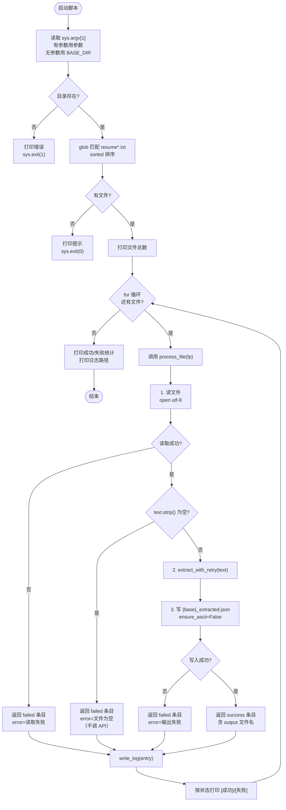
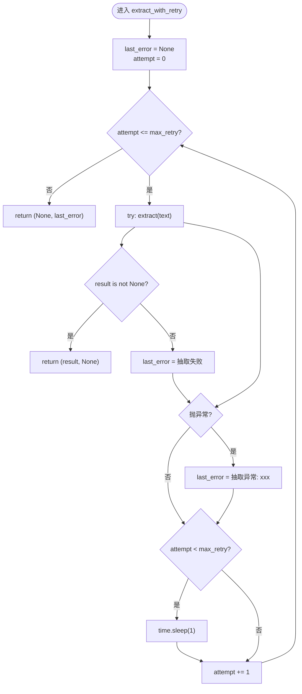
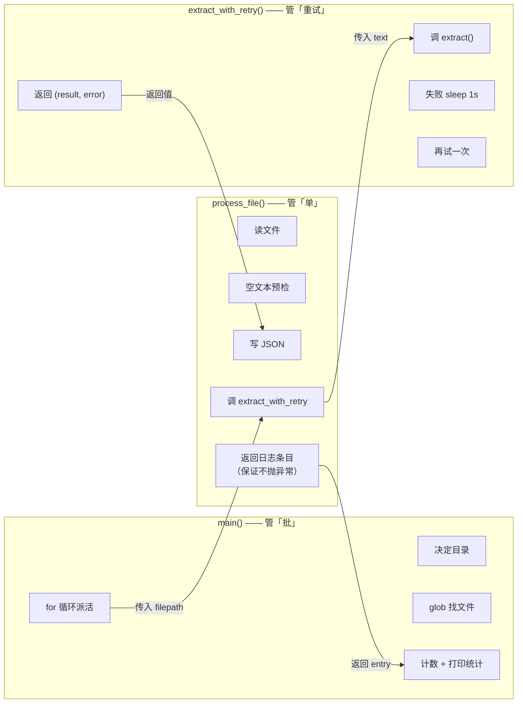
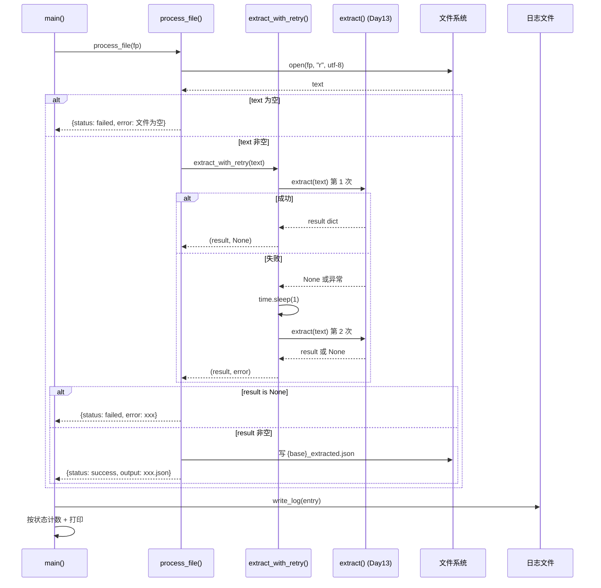

# Day20 批量抽取容错 + 重试 + 日志 · 流程图

> 脚本：`basic/2-week2/day13/day20_batch_extract_cli.py`
> 复用：`day13_extractor.extract()`
> 产出：`{原名}_extracted.json` + `extract_log.jsonl`

---

## 一、全景流程图



---

## 二、重试循环流程图（`extract_with_retry`）



---

## 三、三层职责分离图



---

## 四、单文件流水线时序图



---

## 五、纯文本 ASCII 版（无 mermaid 环境可用）

```text
┌──────────────────────────────────────────────────────────────┐
│                         启动脚本                              │
│                    python day20_xxx.py [dir]                 │
└───────────────────────────┬──────────────────────────────────┘
                            ▼
                 ┌─────────────────────┐
                 │  决定 target_dir     │
                 │  argv[1] 或 BASE_DIR │
                 └──────────┬──────────┘
                            ▼
                    ╱ 目录存在？ ╲
                  是 ╱             ╲ 否
                    ▼               ▼
        ┌────────────────┐   ┌──────────────┐
        │ glob resume*.txt│   │ 打印错误      │
        │ sorted 排序     │   │ sys.exit(1)  │
        └───────┬────────┘   └──────────────┘
                ▼
          ╱ 有文件？ ╲
        是╱         ╲否
         ▼           ▼
  ┌────────────┐  ┌──────────────┐
  │ 进入 for   │  │ 打印提示      │
  │ 循环       │  │ sys.exit(0)  │
  └─────┬──────┘  └──────────────┘
        │
        ▼
  ┌──────────────────────────────────────────────────┐
  │          process_file(fp) 单文件流水线            │
  │                                                    │
  │  ┌──────────────┐                                │
  │  │ 1. 读文件     │──失败──▶ 返回 failed 条目      │
  │  └──────┬───────┘                                │
  │         ▼                                         │
  │  ┌──────────────┐                                │
  │  │ 2. 空文本预检 │──空───▶ 返回 failed（不调 API） │
  │  └──────┬───────┘                                │
  │         ▼                                         │
  │  ┌──────────────────────────────┐                │
  │  │ 3. extract_with_retry(text)   │                │
  │  │   ┌────────────────────────┐  │                │
  │  │   │ for attempt in 0..1:    │  │                │
  │  │   │   extract(text)         │  │                │
  │  │   │   成功 → return         │  │                │
  │  │   │   失败 → sleep 1s       │  │                │
  │  │   └────────────────────────┘  │                │
  │  │   两次都失败 → 返回 failed 条目 │                │
  │  └──────┬───────────────────────┘                │
  │         ▼                                         │
  │  ┌──────────────┐                                │
  │  │ 4. 写 JSON    │──失败──▶ 返回 failed 条目      │
  │  └──────┬───────┘                                │
  │         ▼                                         │
  │  ┌──────────────┐                                │
  │  │ 5. 返回 success│                               │
  │  └──────────────┘                                │
  └──────────────────┬───────────────────────────────┘
                     ▼
        ┌────────────────────────┐
        │ write_log(entry)       │  ← 追加一行 JSONL
        │ 打印 [成功] 或 [失败]   │
        └───────────┬────────────┘
                    ▼
              ╱ 还有下一个？ ╲
            是╱             ╲否
             ▼               ▼
      （回到 for）    ┌──────────────────┐
                     │ 打印成功/失败统计 │
                     │ 打印日志文件路径   │
                     └──────────┬───────┘
                                ▼
                             [结束]
```

---

## 六、关键设计点速查

| 设计点 | 做法 | 为什么 |
| :--- | :--- | :--- |
| 路径锚定 | `BASE_DIR = os.path.dirname(os.path.abspath(__file__))` | 不依赖当前工作目录，Day15/Day19 已踩两次 |
| 三层职责 | `main` 管批 / `process_file` 管单 / `extract_with_retry` 管重试 | 改一处不动全身 |
| 异常契约 | `process_file` 保证不抛异常 | 主循环 `for` 里不写 `try/except`，单条失败天然不中断 |
| 空文本预检 | `.strip()` 一判，直接返回 failed | 省两次 API 调用 + 2 秒 sleep |
| 重试范围 | 只重试「返回 None」和「抛异常」 | 空文件、读失败等确定性错误不重试 |
| 重试间隔 | `time.sleep(1)` | 防 429 限流 |
| 判定成功 | `if result is not None` | 空字典 `{}` 是假值，`if result` 会误判 |
| 日志格式 | JSONL，`json.dumps(..., ensure_ascii=False)` | 追加写 O(1)，中文不变 `\uXXXX` |
| 落盘时机 | 每个文件处理完立刻 `write_log`，再打印 | 进程被 Ctrl+C 也不丢日志 |
| 退出码 | 目录不存在 `exit(1)`，无文件 `exit(0)` | CI/shell 可区分「错误」和「没活干」 |

---

## 七、四件套对照（今天必须记住）

```text
try/except   →  process_file 内部分段捕获（读 / 抽 / 写）
continue     →  单文件失败返回 failed 条目，for 循环继续下一个
重试          →  extract_with_retry 内部 for + sleep 1s，最多 2 次
日志          →  write_log 追加写 JSONL，先落盘再打印
```

**一句话**：单条失败不中断整体，所有异常必须留痕可回溯。